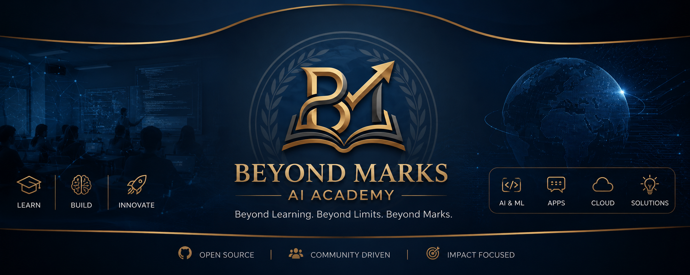

<!-- github-profile-readme -->

  

[**Website**](https://beyondmarks.ai) &nbsp;&middot;&nbsp; [**Explore projects**](https://github.com/beyondmarks-ai?tab=repositories) &nbsp;&middot;&nbsp; [**Follow our work**](https://github.com/beyondmarks-ai?tab=followers)

 

## Engineering education that ships

Beyond Marks AI Academy is an engineering-focused learning community in India. We help the next generation move beyond grades by designing, building, and shipping useful software across AI, cybersecurity, developer tools, mobile, and the modern web.

- **Applied AI:** practical products powered by LLMs, machine learning, and responsible cloud integrations
- **Secure engineering:** threat analysis, trusted software delivery, and privacy-conscious architecture
- **Product building:** real-world applications for Windows, Android, cloud, and the web
- **Learning by doing:** project-based education with production-minded engineering habits

## Featured engineering

| Project | What it does | Core stack |
|---|---|---|
| [**App Forger**](https://github.com/beyondmarks-ai/App_Forger) | Discovers trusted Windows software and verifies downloads with SHA-256 and Authenticode. | Python · PySide6 · Azure OpenAI |
| [**Threat Lens**](https://github.com/beyondmarks-ai/Threat-Lens) | Analyzes URLs for phishing signals, TLS issues, redirects, typosquatting, and threat-intelligence matches. | Go · Svelte · Docker |
| [**ShortcutX**](https://github.com/beyondmarks-ai/ShortcutX) | Maps mouse gestures and global shortcuts to powerful productivity actions in Windows. | C# · WPF · .NET |
| [**Vaani Setu**](https://github.com/beyondmarks-ai/Vaani-Setu-Beta) | Connects users through real-time audio rooms using simple six-digit Vaani numbers. | Flutter · Firebase · LiveKit |
| [**Refiner**](https://github.com/beyondmarks-ai/Refiner) | Adds AI-powered rewriting directly to Android's native text-selection menu. | Flutter · Kotlin · Azure Functions |
| [**Academy Platform**](https://github.com/beyondmarks-ai/Beyond-Marks-AI-Academy) | Delivers an AI-literacy and skill-mastery curriculum through a responsive learning experience. | React · Vite · Framer Motion |

## Technology landscape

## Open-source activity

  

[Browse all repositories](https://github.com/beyondmarks-ai?tab=repositories) &nbsp;&middot;&nbsp; [Visit beyondmarks.ai](https://beyondmarks.ai)

---

  <strong>Learn deeply. Build boldly. Share openly.</strong> 
  Beyond Marks AI Academy · Bidar, Karnataka, India

